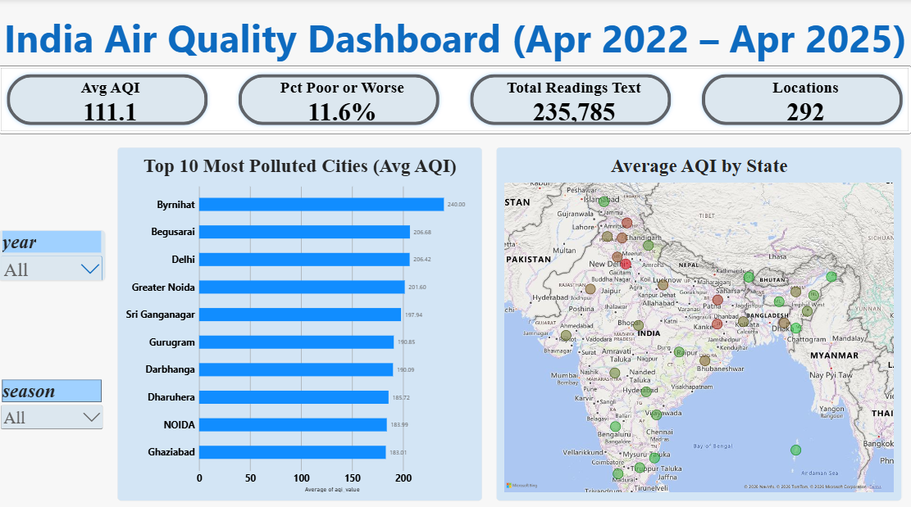
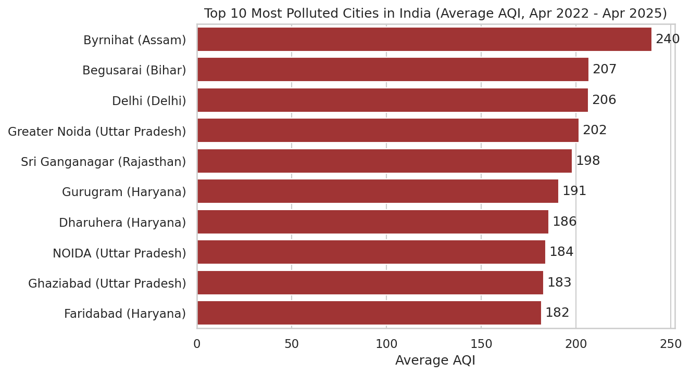
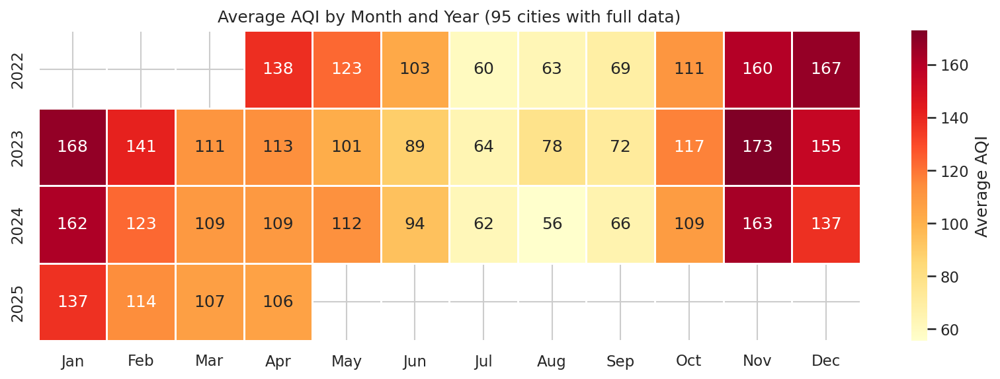
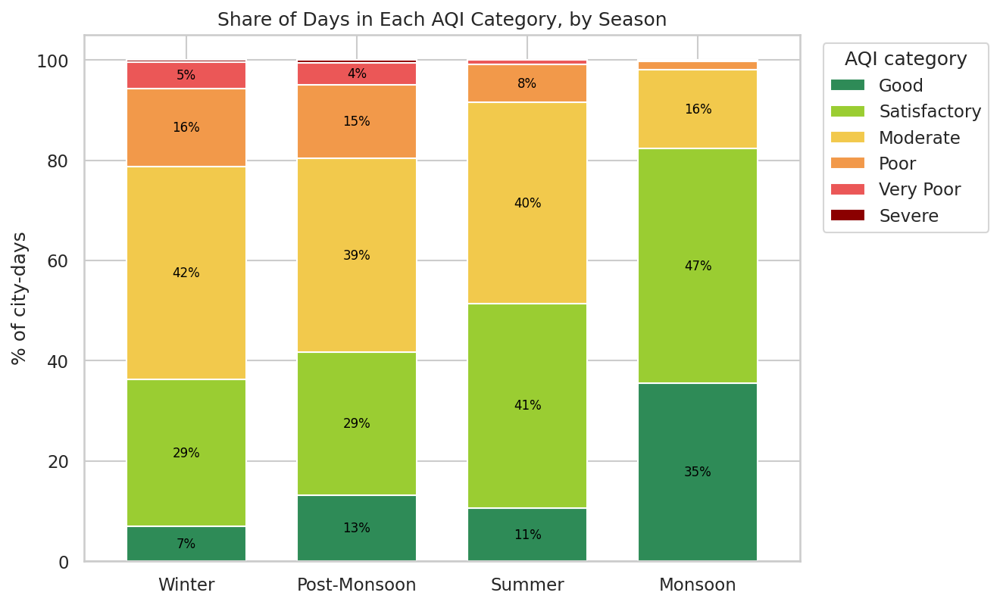
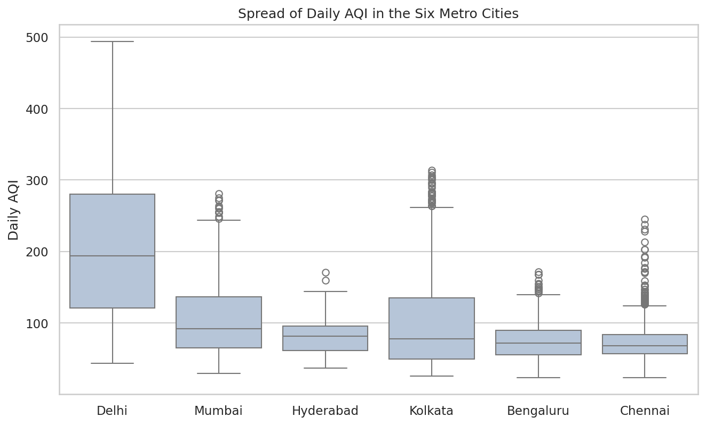
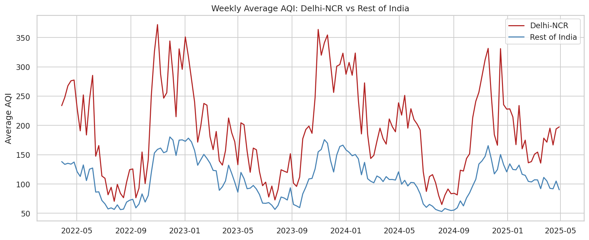
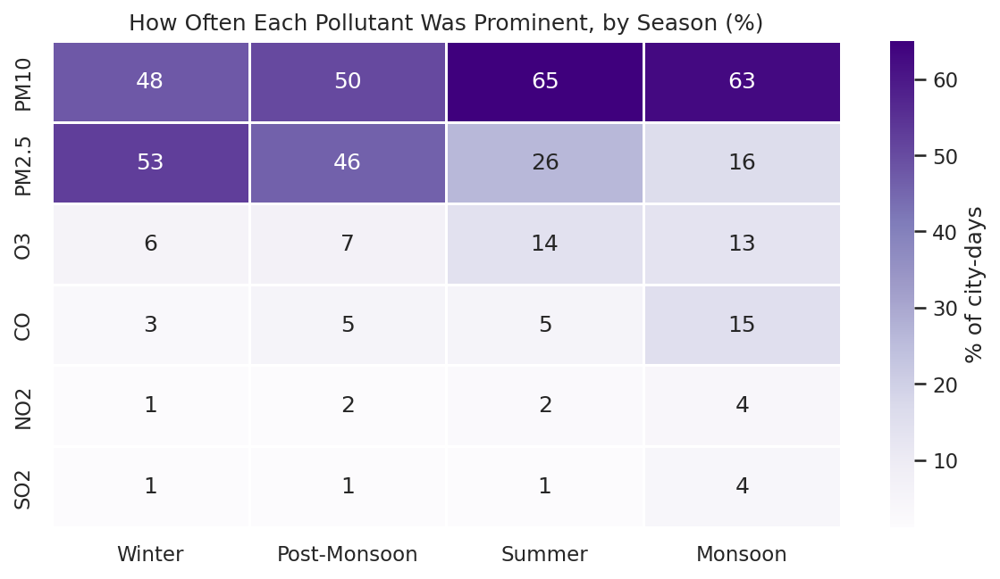
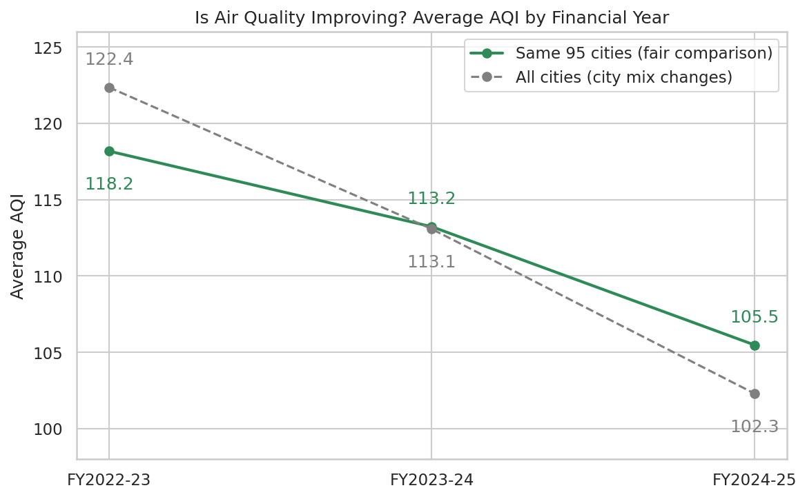
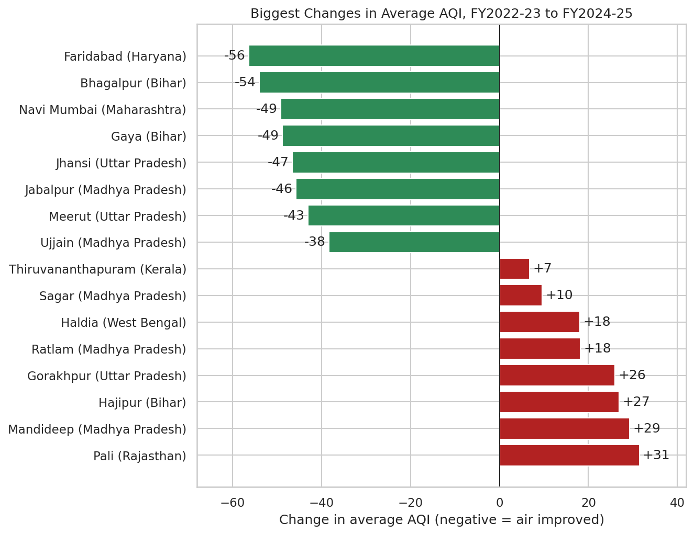
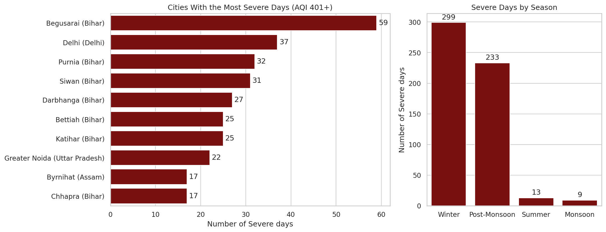

# Air Quality Analysis of Indian Cities (Apr 2022 – Apr 2025)

An end-to-end data analysis project on daily Air Quality Index (AQI) readings from Indian cities. The data is cleaned and explored in **Python**, queried in **MySQL**, and presented in an interactive **Power BI** dashboard.

**Main question:** Where and when is India's air quality at its worst, and what drives it?

---

## Dashboard preview

| Overview | Trends and Seasons | Cities and Extremes |
|---|---|---|
|  |  |  ||

The dashboard file is `powerbi_dashboard/aqi_dashboard.pbix` (open it with Power BI Desktop, which is free for Windows).

---

## Dataset

- **Source:** [India Air Quality Index (AQI) Dataset [2023–2025]](https://www.kaggle.com/datasets/saikiranudayana/india-air-quality-index-aqi-dataset-20232025) by Saikiran Udayana, on Kaggle.
- **Period actually covered:** 1 Apr 2022 to 30 Apr 2025, although the Kaggle title says 2023–2025.
- **Size after cleaning:** 235,785 rows, 24 columns, 32 states and union territories, 292 locations.
- Please check the dataset's license on Kaggle before reusing the data.

---

## Tools used

| Stage | Tool |
|---|---|
| Cleaning and exploration | Python (pandas, matplotlib, seaborn), Jupyter Notebook |
| Querying and business questions | MySQL |
| Dashboard | Power BI Desktop (DAX measures, slicers, map, charts) |

---

## Project workflow

1. **Data understanding and cleaning** (`Python/01_data_understanding_and_cleaning.ipynb`): checked the structure, fixed types and missing values, and added new columns such as `year`, `month`, `season`, `aqi_category` and a Poor-or-worse flag. Split the prominent-pollutant text into one column per pollutant.
2. **Visualization** (`Python/02_visualization.ipynb`): nine charts answering the main question (see below).
3. **SQL analysis** (`SQL/`): loaded the cleaned file into MySQL, found and removed duplicate rows, and answered business questions such as the worst cities, seasons and pollutants.
4. **Dashboard** (`powerbi_dashboard/`): three interactive pages built on the cleaned data.

---

## Key findings

- **Winter is the worst season.** Average AQI is about **143** in winter and about **72** during the monsoon.
- **Delhi-NCR is far more polluted than the rest of India.** Its average AQI is about **191**, against about **109** elsewhere.
- **Delhi is the most polluted state or union territory** at about **206** on average, followed by Jharkhand (~165) and Himachal Pradesh (~160).
- **Byrnihat has the highest city average** (~240), followed by Begusarai (~207) and Delhi (~206).
- **Begusarai recorded the most Severe days** (59 of the 554 Severe readings overall), followed by Delhi (37) and Purnia (32).
- **PM10 is by far the most common prominent pollutant**, followed by PM2.5. Together they appear on most days.
- **About 11.6% of all readings were Poor or worse**, and the overall average AQI was **111.1**.
- **Winter peaks seem to fall each year.** The monthly average reached about 174 in Dec 2022, about 167 in Nov 2023 and about 153 in Nov 2024.

---

## Charts from the Python analysis

| | |
|---|---|
|  |  |
|  |  |
|  |  |
|  |  |
|  | |

---

## Dashboard pages

1. **Overview:** KPI cards (average AQI, share of Poor-or-worse days, total readings, locations), a map of average AQI by state, the 10 most polluted cities, and slicers for year and season.
2. **Trends and Seasons:** monthly average AQI, AQI category mix by season, and Delhi-NCR compared with the rest of India. Slicers for state and region.
3. **Cities and Extremes:** the 10 cleanest cities, the cities with the most Severe days, and the prominent pollutant breakdown. Slicers for state and area.

**Delhi-NCR here means:** Delhi, Noida, Greater Noida, Ghaziabad, Gurugram and Faridabad.

---

## Repository structure

```
india-air-quality-analysis/
├── data/
│   ├── raw/aqi.csv
│   └── cleaned/aqi_cleaned.csv
├── Python/
│   ├── 01_data_understanding_and_cleaning.ipynb
│   ├── 02_visualization.ipynb
│   └── v1 … v9 chart images (.png)
├── SQL/
│   ├── 01_create_database_and_table.sql
│   ├── 02_verify_import.sql
│   ├── 03_fix_duplicates.sql
│   └── 04_business_queries.sql
├── powerbi_dashboard/
│   ├── aqi_dashboard.pbix
│   └── screenshots/
└── README.md
```

---

## How to reproduce

1. Download the raw dataset from Kaggle (or use `data/raw/aqi.csv` if included), and keep it in `data/raw/`.
2. Run `Python/01_data_understanding_and_cleaning.ipynb` to produce `data/cleaned/aqi_cleaned.csv`.
3. Run `Python/02_visualization.ipynb` to recreate the charts.
4. In MySQL, run the scripts in `SQL/` in numeric order. Import `aqi_cleaned.csv` after script 01.
5. Open `powerbi_dashboard/aqi_dashboard.pbix` in Power BI Desktop. If it asks for the data, point it to `data/cleaned/aqi_cleaned.csv`.

Python libraries needed: `pandas`, `numpy`, `matplotlib`, `seaborn`, `jupyter`.

---

## Limitations

- Readings come from the dataset as published, and monitoring coverage differs between cities. Cities with few readings can look unusually clean or polluted.
- Calendar-year averages are not directly comparable, because 2022 starts in April and 2025 ends in April.
- The analysis is descriptive and does not claim causes.

---

## Author

**SADIQA BANU** (https://github.com/SADIQABANU)
